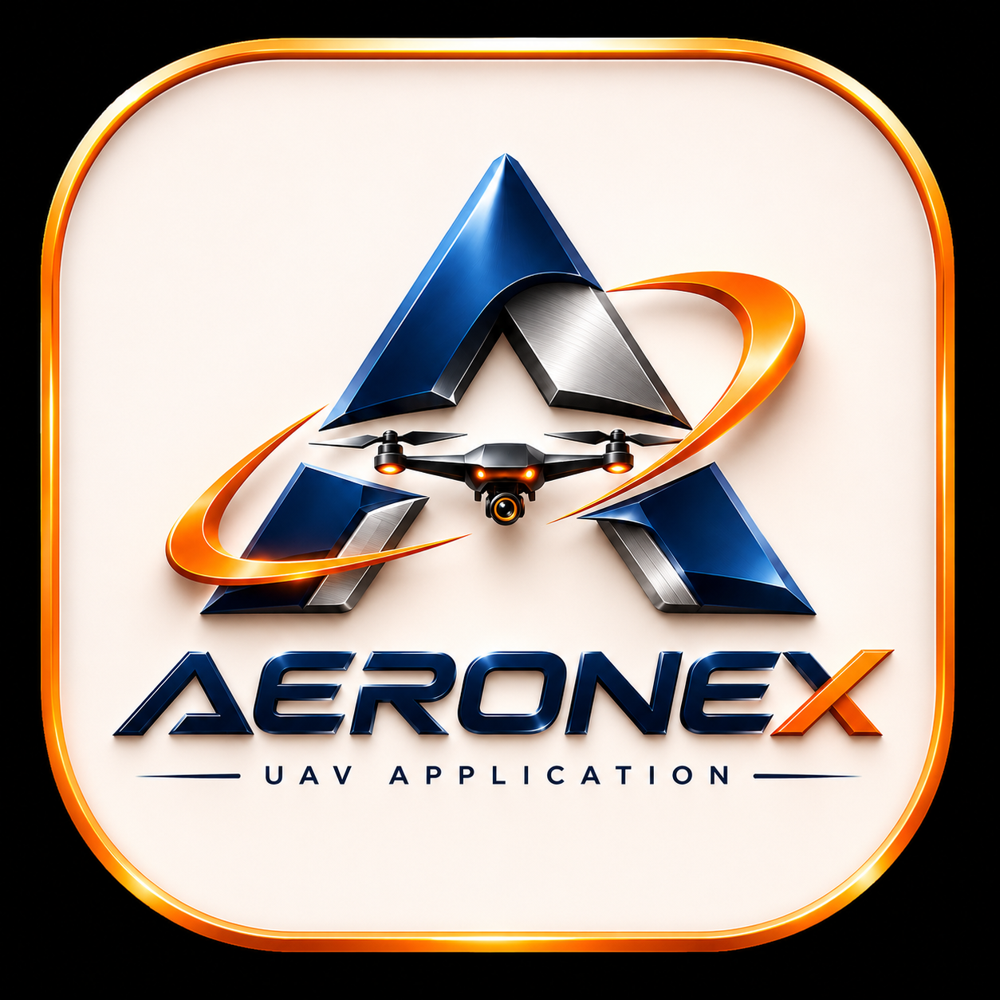
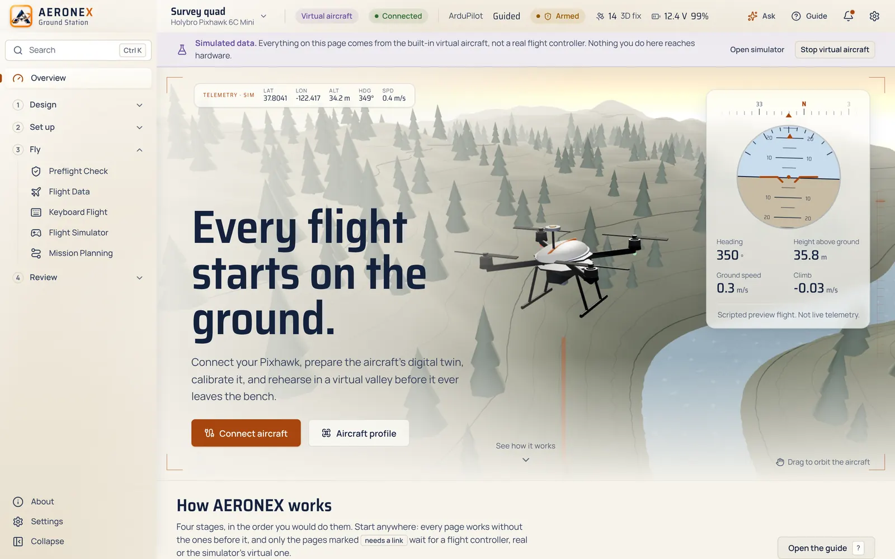
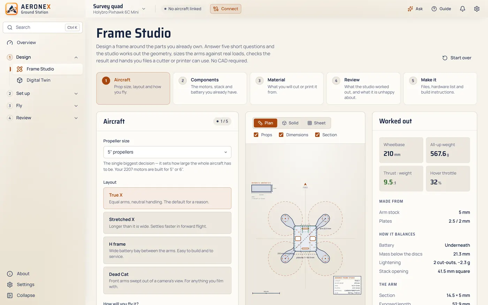
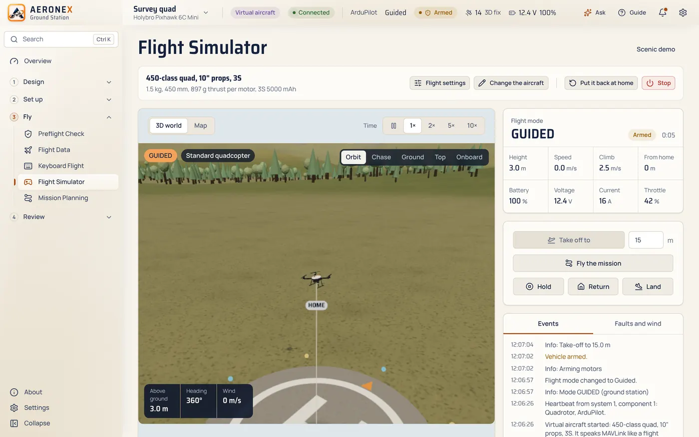
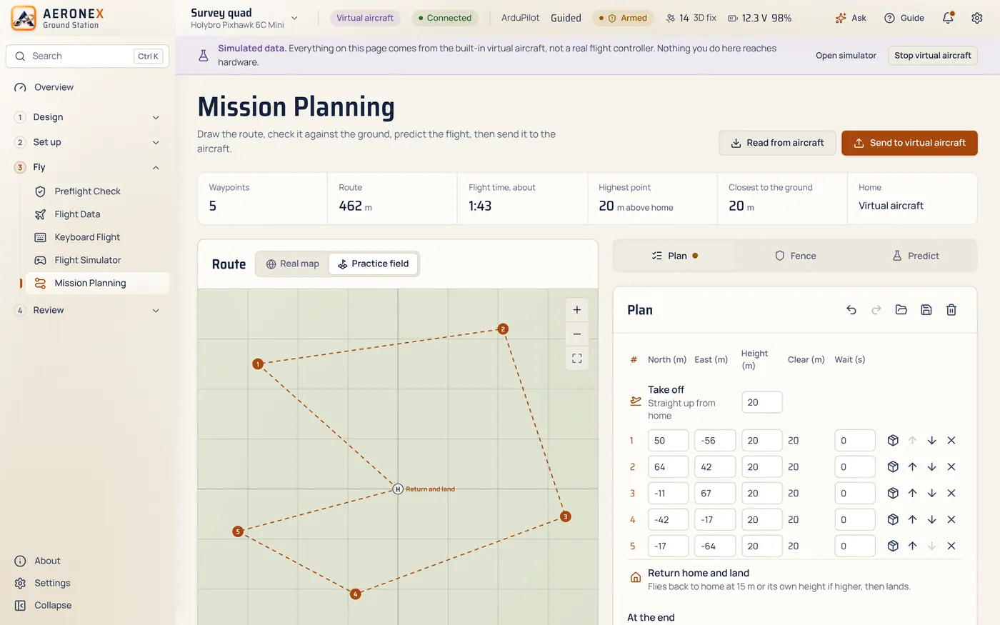
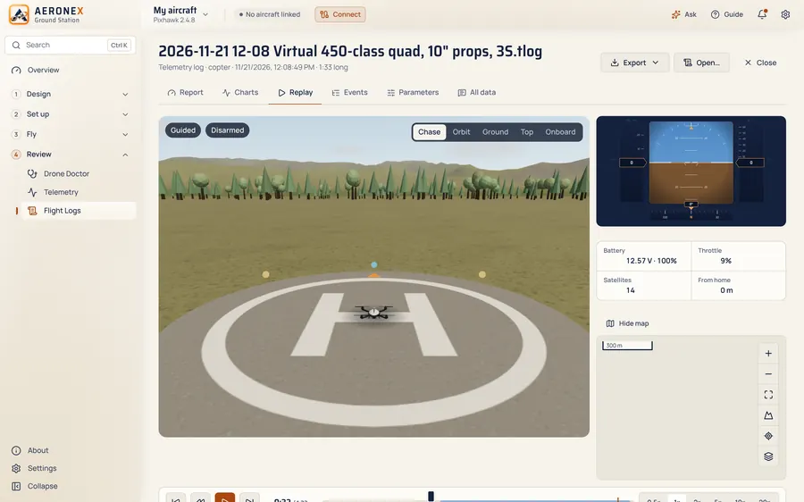

<p align="center">
  
</p>

<h1 align="center">AERONEX Ground Station</h1>

<p align="center">
  A free, open-source ground station for ArduCopter drones on Windows.<br />
  Design the aircraft, set it up, rehearse in a simulator, fly it, and review the flight, all in one app.
</p>

<p align="center">
  <a href="https://github.com/Dwijvyas-9926/AERONEX/releases/latest"></a>
  <a href="https://github.com/Dwijvyas-9926/AERONEX/actions/workflows/ci.yml"></a>
  <a href="LICENSE"></a>
  
</p>

<p align="center">
  <a href="https://aeronexstation.vercel.app"><strong>Website</strong></a> ·
  <a href="https://aeronexstation.vercel.app/#download"><strong>Download</strong></a> ·
  <a href="docs/FEATURES.md"><strong>Features</strong></a> ·
  <a href="docs/DEVELOPMENT.md"><strong>Build from source</strong></a> ·
  <a href="CHANGELOG.md"><strong>Changelog</strong></a>
</p>

<p align="center">
  <a href="https://aeronexstation.vercel.app/#film"></a>
</p>

## Download

Get the installer from the [website](https://aeronexstation.vercel.app/#download) or the
[latest release](https://github.com/Dwijvyas-9926/AERONEX/releases/latest), and run
`AERONEX-Setup-<version>.exe`. It installs for your Windows user only, with no administrator
rights needed, and keeps itself up to date.

Windows may show **"Windows protected your PC"** until the installer is code-signed: choose
**More info**, then **Run anyway**. See the [code signing policy](https://aeronexstation.vercel.app/code-signing).

**Requirements:** Windows 10 or 11, 64-bit. A flight controller is optional: everything can be
tried on the built-in virtual aircraft.

## What it does

| | |
| --- | --- |
| **Frame Studio** | Design a frame around the parts you own, and get the files to cut or print with a parts list. |
| **Digital Twin** | Import the real CAD model (STEP, GLB, OBJ, STL), set which way is forward and up, and fly it. |
| **Connection and telemetry** | MAVLink over USB or a telemetry radio, every frame checked, stale readings marked. |
| **Firmware** | Install the latest stable ArduCopter, with the right build picked for the board and verified. |
| **Set up** | Sensor, radio, ESC and flight-mode calibration, motor test, PID tuning, servo outputs and parameters with ArduPilot's own documentation. |
| **Preflight check** | A go or no-go verdict that follows ArduCopter's own pre-arm checks. |
| **Fly** | A primary flight display, keyboard flight in GUIDED mode, and a physics simulator with wind and faults. |
| **Mission planning** | Waypoints on a real map over measured ground, a geofence, payload delivery, and a flight-time prediction. |
| **Drone Doctor** | A health scan of the connected aircraft that says what is wrong and how to fix it. |
| **Flight logs** | Open `.bin` and `.tlog` files, find vibration, power and GPS problems, chart any field and replay the flight in 3D. |
| **Assistant** | Ask questions about the app or your drone, with your own Anthropic API key. |

Every page says what it does and what it does not; the details are in [docs/FEATURES.md](docs/FEATURES.md).

<p align="center">
  
</p>

<table>
  <tr>
    <td></td>
    <td></td>
  </tr>
  <tr>
    <td></td>
    <td></td>
  </tr>
</table>

## Supported hardware

Built for **ArduCopter 4.6 and 4.7** on **Pixhawk 2.4.8**, **Holybro Pixhawk 6C Mini** and other
MAVLink flight controllers. Other autopilots, PX4 and ArduPlane included, are shown and read, but
AERONEX never sends them a command that moves an aircraft.

## Safety

AERONEX is not flight-certified, and the pilot is responsible for every flight. Commands go only
to ArduCopter, and the app waits for the aircraft to confirm each one. Motor tests need props off,
and a lost link hands over to the aircraft's own failsafe. Do a props-off bench test and a cautious
first flight with any new aircraft or setting.

## Privacy

There are no accounts, no analytics and no AERONEX server. Your aircraft, plans, logs and settings
stay on your computer. The few things fetched from the internet (updates, firmware, maps, and the
assistant if you add a key) are listed on the [privacy page](https://aeronexstation.vercel.app/privacy).

## Build from source

```bash
git clone https://github.com/Dwijvyas-9926/AERONEX.git
cd AERONEX
npm install
npm run dev          # in a browser
npm test             # unit tests
npm run dist:win     # the Windows installer (on Windows)
```

Requires Node.js 20.19+ or 22.12+. The project layout, tests and the ArduCopter simulator tests are
described in [docs/DEVELOPMENT.md](docs/DEVELOPMENT.md); how the project is run and released in
[docs/MAINTAINING.md](docs/MAINTAINING.md) and [docs/RELEASING.md](docs/RELEASING.md).

## Contributing

Bug reports, ideas and pull requests are welcome. Please read [CONTRIBUTING.md](CONTRIBUTING.md)
and the [code of conduct](CODE_OF_CONDUCT.md). To report a security problem privately, see
[SECURITY.md](SECURITY.md).

## Creator

AERONEX is designed and built by **[Dwij Vyas](https://github.com/Dwijvyas-9926)**, Electronics and
Communication Engineer at Birla Vishvakarma Mahavidyalaya (BVM), Vallabh Vidyanagar. It grew out of
Avion, a disaster-relief drone project.

## Licence

AERONEX is open source under the [Apache License 2.0](LICENSE). Copyright 2026 Dwij Vyas.

The licence covers the code. It does not grant use of the AERONEX name or logo. AERONEX is provided
as it is, without warranty.

Some included material keeps its own licence, listed in [NOTICE](NOTICE): ArduPilot's parameter
definitions are GPL-3.0 ([LICENSES/GPL-3.0.txt](LICENSES/GPL-3.0.txt)), and the bundled libraries
are listed with their licences in [THIRD-PARTY-NOTICES.txt](THIRD-PARTY-NOTICES.txt).

ArduPilot, ArduCopter, Pixhawk and MAVLink are trademarks of their respective owners. AERONEX is an
independent project and is not affiliated with or endorsed by them.
